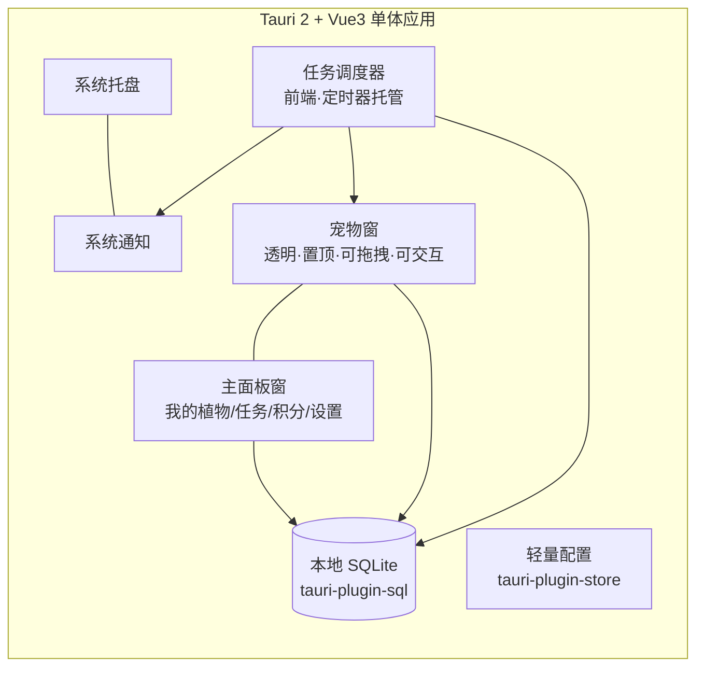
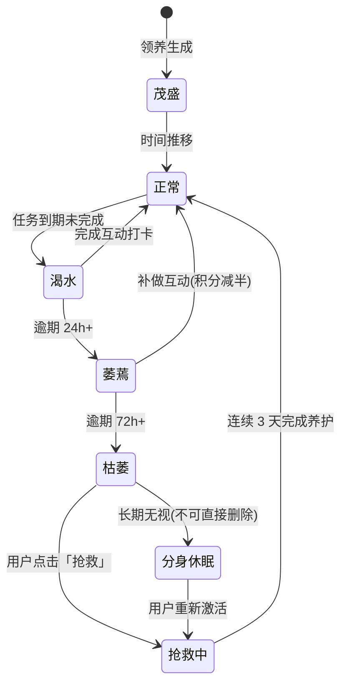

# 植物数字分身桌面宠物 · 技术方案

> 版本：v0.2 · 日期：2026-10-21
> 状态：关键决策已确认（见 §2），剩余待澄清项见 §10，不阻塞 Phase 0 / Phase 1 启动
> 变更：v0.1 → v0.2 落地七项决策；第一期调整为「固定物种 + 桌面互动 + 纯单机」；移除 AI 生成分身

---

## 1. 项目概述

**一句话定位**：公司/园区「绿植领养活动」的桌面配套工具——员工领养真实植物后，在桌面养一株对应的数字分身；工具按植物习性提醒浇水、晒太阳，员工线下照护后回到桌面互动打卡，积累积分兑换线下权益。

**核心循环（Core Loop）**：

```
领养植物 → 桌面生成专属数字分身 → 按习性生成养护计划（浇水/晒太阳）
    ↑                                        ↓
积分兑换线下权益 ← 打卡得分/好感度成长 ← 桌面互动（浇水/抚摸/晒太阳）→ 线下照护真实植物
```

**产品关键点**：

- 「每个人都不一样」：分身由物种模板 + 确定性随机种子生成（不含 AI 生成），同人同株永远同一分身。
- 线上互动是线下照护的「打卡仪式」，不替代真实照护。
- 积分最终兑换**线下权益**（由活动承办方提供与核销）。

---

## 2. 已确认决策记录（2026-10-21）

| # | 问题 | 决策 |
|---|---|---|
| D1 | 目标场景 | 公司/园区活动配套工具，非公开 C 端产品 |
| D2 | 目标平台 | Windows + macOS 双平台，暂不考虑 Linux 与移动端 |
| D3 | 积分用途 | 兑换线下权益（周边/券等，具体待活动方定），涉及承办方核销 |
| D4 | 分身生成 | **不接入 AI 生成**，采用「物种模板 + 种子随机特征 + 成长阶段」方案，长期有效 |
| D5 | 离线触达 | 应用未运行时收不到提醒**可接受**；依靠开机自启保证常驻；微信通道降为远期可选项 |
| D6 | 打卡验证 | 信任制打卡；拍照校验仅作为远期积分加成选项，不做强制 |
| D7 | Rust 储备 | 团队无 Rust 经验 → 执行「Rust 零代码」目标，Phase 0 专项验证 |
| D8 | 第一期范围 | 固定几种植物（素材外采）；桌面端可互动（浇水、抚摸等）；**不与服务端交互**，纯单机 |
| D9 | 互动与计分（2026-10-22 确认） | 浇水/晒太阳**随时可互动**（按钮常驻，到期高亮）；计分以「下一个待办任务」为锚点：提前 +8 / 按时 +10 / 逾期补做 +5 / 无待办任务 0 分；**完成即消耗，下一轮从当下重新起算**；每日互动积分总上限 20（好感度不受限） |
| D10 | 素材风格（2026-10-22 确认） | **卡通风格**；素材全量 AI 生成（采购路线废止），提示词与切图管线见《AI生图与切图管线.md》 |
| D11 | 生图通道（2026-10-22 确认，同日收敛） | 即梦手工 → AI 接口自动生成：先接 zeakai edits，后收敛为火山方舟 Ark `doubao-seedream-5-0-flash` 图生图（见 D15）；仍产白底图，沿用抠白底切图管线；备选即梦参考图模式（idle 换物种漂移时兜底） |
| D12 | 生图自动化边界（2026-10-22 确认） | 目检永远人工，衍生帧参考图必须来自人工定稿的 idle FINAL；`species.ts` 养护参数永远人工确认；物种文案 AI 起草、人工过目后入库 |
| D13 | MAP 形态（2026-10-22 确认） | 扩展为「硬编码表 + `assets-src/{dir}/map.json`」合并，`process-sprites.mjs` 对既有 24 帧零行为变化 |
| D14 | 文案生成通道（2026-10-22 确认并修订） | 起草物种段/状态句：JSON schema 约束 + 人工过目后入库，风格段/载体段与养护参数不在 AI 可生成范围；文本通道原定 zeakai `gpt-5.5`，因其返回异常改为火山方舟 Ark `doubao-seed-2-1-lite-260915`（Responses API） |
| D15 | 生图供应商收敛（2026-10-22 确认） | 曾配 zeakai/ark 双供应商切换，因出图质量相当、为简化运维**移除 zeakai，全局使用火山方舟 Ark**：`doubao-seedream-5-0-flash-260915` 图生图 + `doubao-seed-2-1-lite-260915` 文案，`ARK_API_KEY` 一把钥匙；模型/尺寸在 `scripts/sprite-config.json` |

---

## 3. 技术选型：Tauri 2（结论）

### 3.1 三者对比

| 维度 | **Tauri 2** ✅ | Electron | Electrobun |
|---|---|---|---|
| 安装包体积 | 3~10 MB | 80~150 MB | 极小 |
| 常驻内存 | 低（系统 WebView） | 高（捆绑 Chromium，150~300MB+） | 低 |
| 成熟度 | 稳定（v2 已 GA，生态完善） | 最成熟，10 年+ | **早期 alpha，API 不稳定** |
| 桌面宠物刚需能力 | 透明窗/置顶/点击穿透/托盘/通知/自启动/自动更新均有官方插件 | 全部支持 | 托盘、通知、自启动等能力不全，目前主推 macOS |
| 前端技术栈 | Vite + Vue3 原生支持，零迁移 | 同样支持 | 支持（Bun 生态） |
| 跨平台 | Win / macOS（v2 另实验支持 iOS/Android） | Win / macOS / Linux | 目前主要 macOS |
| 对本项目最大风险 | 需少量 Rust 能力（D7：以零 Rust 代码为目标规避） | 常驻应用体积内存过大 | 项目未生产就绪，随时破坏性变更 |

### 3.2 决策理由

1. **桌面宠物是「全天候常驻」应用**，内存与体积是第一体验指标。Electron 挂一个 Chromium 长期运行不划算；Electrobun 未生产就绪。
2. **官方插件覆盖本项目全部系统能力**：`notification`（提醒）、`tray`（托盘）、`autostart`（开机自启，D5 的关键依赖）、`store` / `sql`（本地存储）、`updater`（自动更新）。
3. **前端零成本匹配现有技能栈**：Vue3 + Vite + Pinia + Element Plus。
4. **D7 应对——「Rust 零代码」原则**：业务逻辑 100% 在 TS 前端；系统能力只用官方插件与 `@tauri-apps/api`；窗口属性（透明/置顶/穿透/尺寸）全部在 `tauri.conf.json` 或 JS API 中声明。Phase 0 用清单逐项验证「不写一行 Rust 能否全量实现」，若有缺口，优先换前端方案或换插件，而不是引入 Rust 代码。

---

## 4. 整体架构

### 4.1 第一期架构（纯单机，无服务端）



- **宠物窗**：渲染分身（序列帧/CSS 动画）、状态气泡、承接互动手势（浇水/抚摸/晒太阳）。
- **主面板窗**：Element Plus，领养引导、任务列表、积分流水、好感度、设置（免打扰/提醒时间偏移/退出领养）。
- **托盘**：快捷菜单（立即查看任务/暂停提醒 N 小时/退出）、应用生命周期兜底。
- **无任何网络依赖**：断网全功能可用（D8）。

### 4.2 远期架构预留（Phase 2，是否启动见 §10-Q1）

若活动需要积分总账可信与线下权益核销，再引入服务端：业务 API（NestJS/Express + PostgreSQL 或 Supabase）+ 轻量运营后台（权益配置、核销、数据看板）。本地表结构在 §6 已按可同步设计，届时增量迁移，不推翻。

---

## 5. 核心业务流程（结构化）

### 5.1 领养与分身生成流程

**入口**：主面板「领养植物」；首次启动引导页。

1. 用户从**固定物种库**（第一期 6~8 种常见办公植物，清单见 §9）中选择物种。
2. 用户填写：植物昵称（输入）、领养日期（默认今天）。
3. 系统生成分身：
   - 物种 → 决定基础模板（形态、默认动画组）；
   - `seed = hash(userId + plantId + 领养时间)` → 决定随机特征：色相偏移、叶斑/花纹、体型微调、初始表情、出生配饰；
   - 同一植物重进应用外观不变（确定性渲染）。
4. 系统按物种习性生成默认养护计划（浇水间隔/晒太阳间隔，物种库配置），用户可调整。
5. 分身以成熟期形态出现在桌面（位置默认屏幕右下，可拖拽，位置持久化）。

**异常分支**：
- 1a. 物种库为空/资源缺失 → 领养入口置灰并提示，禁止进入空态流程。
- 2a. 昵称为空 → 默认使用物种名。
- 4a. 用户自定义间隔 < 物种最小建议值 → 给出提示但允许（信任用户）。
- 5a. 取消领养 → 不落库。

### 5.2 桌面互动流程（第一期核心体验，D8）

**总规则**：互动即打卡。到期任务的完成方式就是在宠物身上完成对应互动，不再单独设计「打卡按钮」。

| 互动 | 触发方式 | 表现 | 效果 |
|---|---|---|---|
| 浇水 | 💧 按钮**常驻**（平时半透明），到期高亮脉冲；随时可点 | 洒水动画、土壤变色、满足表情 | 计分见 D9 锚点规则 |
| 晒太阳 | ☀️ 按钮常驻，到期高亮；随时可点 | 发光动画 | 计分见 D9 锚点规则 |
| 抚摸 | 鼠标在分身上按住缓慢划动（stroke 手势） | 眯眼、叶片轻摇、冒爱心粒子 | 好感度 +N；**每日前 3 次**额外 +2 积分（防刷上限） |
| 逗弄/点击 | 单击 | 随机小反应（眨眼/弹跳/说话气泡） | 纯趣味，不计分 |
| 拖拽 | 抓住花盆拖动 | 挂起姿态，松手落回 | 位置持久化 |

**计分锚点规则（D9，2026-10-22 确认）**：

| 操作时刻 | 任务结果 | 积分 | 好感度 |
|---|---|---|---|
| 无待办任务（刚照顾过又点） | 计划不变，趣味反馈 | 0 | +1 |
| 有待办、未到期（提前照顾） | 任务完成，下一轮从当下起算 | +8 | +1 |
| 已到期 24h 内（响应提醒） | 任务完成 | +10 | +1 |
| 逾期 24h+（补救） | 任务完成（补做标记） | +5 | +1 |

防刷三闸门：任务完成即消耗 + 唯一键防重、下一轮间隔从当下重置（每周期窗口最多一次计分）、**每日互动积分总上限 20**（超出只给好感度）。

**边界规则**：
- 互动进行中锁手势（动画播完前不重复触发）。
- 免打扰时段：气泡与提醒静默，互动仍可用，完成后正常计分。

### 5.3 提醒流程

1. 调度器（前端，定时器统一托管）按养护计划滚动生成 `care_task`。
2. 到期 → 系统通知 + 宠物气泡 + 分身进入「求关注」待机动画（踱步/探头）。
3. 「稍后提醒」：气泡与通知均可 snooze（默认 +2h，最多 3 次）。
4. 逾期升级：24h+ 气泡变着急表情、通知文案升级；72h+ 停止追加通知（降骚扰），仅在打开应用/托盘角标呈现。

**异常分支**：
- 2a. 通知权限被拒 → 首启引导开启；失败则宠物气泡为唯一兜底，托盘图标加角标。
- 1a. 休眠唤醒/改系统时间导致调度漂移 → 调度器每次唤醒时对账重算（`scheduled_at` 与真实时钟比对，漏发的立即补提示）。

### 5.4 逾期与分身状态机



> 设计原则：**分身永不真正死亡**（活动场景避免负面体验劝退），最差进入休眠，随时唤醒。状态驱动待机动画、气泡与积分系数。

### 5.5 积分与好感度规则（草案，数值上线前可调）

| 行为 | 积分 | 好感度 | 说明 |
|---|---|---|---|
| 提前完成浇水/晒太阳 | +8 | +1 | 任务未到期时照顾，完成即消耗 |
| 按时完成浇水/晒太阳 | +10 | +1 | 到期 24h 内响应提醒 |
| 逾期 24h 内补做 | +5 | +2 | 保底激励 |
| 逾期未做 | 0，分身降状态 | -3 | 不扣积分，避免挫败 |
| 抚摸 | 每日前 3 次各 +2 | +1/次 | 有日上限 |
| 连续 7 天全部按时 | +50 | +10 | streak 里程碑 |
| 每日首次打开应用 | +2 | 0 | 拉活跃 |

- **每日互动积分总上限 20 分**（D9）：覆盖浇水/晒太阳/抚摸等所有积分来源，超出部分只给好感度；好感度不受上限约束。
- **积分**：活动期总账，兑换线下权益（D3）。
- **好感度**：纯养成数值，驱动分身表情/称呼/彩蛋，与积分分离，避免「刷抚摸换权益」。
- 防作弊基线（单机）：任务唯一键防重复、积分只记流水、互动日上限。**已知风险**：本地数据可被篡改，活动场景以「承办方现场核对 + 名单」为第一道防线，彻底解决依赖 Phase 2 上云（§10-Q1）。

### 5.6 数据依赖清单（第一期，全部本地）

| 步骤 | 数据 | 来源 | 消费方 |
|---|---|---|---|
| 领养 | 物种选择 | 用户输入 | 分身生成器、养护计划 |
| 领养 | 昵称/领养日期 | 用户输入 | 植物档案 |
| 生成分身 | 物种模板与习性 | 内置物种配置库（JSON，随包分发） | 分身渲染器、调度器 |
| 生成分身 | seed | hash(userId + plantId + adoptedAt) | 分身渲染器 |
| 互动 | 手势事件 | 宠物窗用户输入 | 动画层、任务状态机 |
| 打卡计分 | 任务完成事件 | 任务状态机 | 积分流水、好感度、streak |

---

## 6. 数据模型（本地 SQLite，`tauri-plugin-sql`）

```text
user        (id, nickname, points_balance_cache, created_at)        -- 单机即「本机用户」
plant       (id, species_code, nickname, adopted_at,
             water_interval_h, sun_interval_h, status)
avatar      (id, plant_id, template_id, seed, traits_json,
             stage[成熟/完全体], mood, exp, affection,
             pos_x, pos_y)                                          -- 桌面位置持久化
care_task   (id, plant_id, type[water/sun], scheduled_at,
             status[pending/reminded/done/overdue/snoozed],
             snooze_count, completed_at)                            -- 唯一键(plant_id,type,scheduled_at)
points_ledger (id, delta, reason, ref_task_id, created_at)          -- 只追加，余额=流水聚合
affection_log (id, delta, reason, created_at)                       -- 同上
streak      (current_count, longest_count, last_full_date)
app_setting (key, value)                                            -- 免打扰时段/托盘偏好等
```

设计约束：
- 积分与好感度**只记流水不直改余额**，余额为聚合缓存，可审计可重算。
- `care_task` 唯一键防重复生成与重复计分（幂等）。
- 表结构预留 `user_id`、`sync_flag` 列空间（Phase 2 同步用，第一期可省略）。

---

## 7. 分期规划

### Phase 0 · 技术验证（1~2 周，含 D7 专项）——门禁，不写业务
- 范围：Tauri 2 + Vue3 + Pinia 脚手架；**「Rust 零代码」清单验证**（透明置顶窗、点击穿透开关、拖拽、系统通知、托盘、autostart、SQLite、开机位置记忆，逐项标注「插件/API 可达 ✅」）；占位精灵动画常驻桌面跑通；Win + macOS 双端实测。
- 验收：双平台稳定常驻 24h，内存占用记录在案且无增长趋势（对照交付门禁）；通知双平台可达；穿透与拖拽不冲突；全部能力确认零 Rust 代码可实现（若发现缺口：换方案并记录，不引入 Rust）。

> **✅ Phase 0 执行结果（2026-10-21，macOS arm64 端已完成）**
>
> 自动验证 6/6 通过：日志（plugin-log→终端）、托盘（JS API 创建+菜单）、KV 配置（plugin-store roundtrip）、SQLite 读写（plugin-sql，重启后数据持久）、开机自启状态、通知权限。拖拽 + 位置记忆跨 3 次重启自动回位验证通过。面板打开时宠物窗已在桌面可交互。
>
> 待人工目视：透明背景观感、置顶效果、通知实际弹出；Windows 端全量验证（需 Windows 机器）；24h 常驻泄漏测试。
>
> **关键发现（Rust 零代码基线的准确表述）**：
> 1. 唯一 Rust 触点是 `main.rs` 的插件注册声明（约 10 行 use+plugin，无任何逻辑）——「零业务 Rust」达成，「绝对零 Rust 文件」不可行。
> 2. tauri 依赖必须开 feature：`macos-private-api`（透明窗）+ `tray-icon`（托盘），且 conf 需 `app.macOSPrivateApi: true`，否则 tauri-build 构建期校验失败。
> 3. capability 细节：`sql:default` 不含 `allow-execute/select`（含 SQL 字符串的命令需显式授权）；`defaultWindowIcon` 需 `core:app:allow-default-window-icon`；权限名是 `allow-get-all-windows`。
> 4. plugin-log 默认 TRACE 噪音大，须设 `.level(Info)`。
>
> **工具链限制（重要）**：本机 rustc 1.86（Homebrew），最新 tauri 线要求 ≥1.90。已将依赖精确固定到兼容线（Cargo.toml 写死 + Cargo.lock 固定）：tauri `=2.11.6`、tauri-build `=2.6.3`、插件 log `2.9.2` / notification `2.4.0` / process `2.3.1` / autostart `2.5.1` / sql `2.4.1` / store `2.4.5`，内部家族 tauri-macros/codegen `2.6.3`、tauri-utils `2.9.3`、tauri-runtime `2.11.3`、tauri-runtime-wry `2.11.4`（wry 0.55.1），传递依赖 time `0.3.45`、uuid `1.26.1`、serde_with `3.17.0`、plist `1.7.4`、url `2.5.4`、idna_adapter `1.1.0`、notify-rust `4.11.5`。**rustc 升到 ≥1.90 后放开为 "2"**。锁定期间不得盲目 `cargo update`。

### Phase 1 · 第一期交付：单机互动版（5~7 周，素材并行外采）
**目标**：员工拿到安装包即可完整体验「领养 → 提醒 → 互动 → 得分 → 分身成长」闭环，全程无网络。

> **进展（2026-10-22，macOS 真机已验证）**：核心闭环已跑通——宠物窗互动（抚摸好感度/戳戳/拖花盆/位置记忆）、养护调度器（任务生成→到期通知+气泡→24h 逾期升级→循环生成）、浇水/晒太阳随时互动打卡（D9 计分锚点 + 每日 20 分上限）、面板任务列表与「稍后」。
>
> **第二批次（同日）**：① 领养流程上线——8 种固定物种库（选物种/昵称/自定义间隔，物种决定分身色相）、无植物引导、重新领养（送别+积分保留）；② 免打扰时段（提醒静默，v1 简化：静默期错过的提醒不补发，悬浮指示仍可见）；③ streak 连击（口径简化：连续每天有养护完成即累计，未做"当日全勤"对账）；④ 成长阶段（按累计完成数：幼年/成长/成熟/完全体，分身尺寸随之变化）；⑤ 面板清理为正式形态（我的植物 + 设置：免打扰/穿透/自启/重新领养）。
>
> **打包（macOS）**：npm 侧包已与 Rust crate 版本精确对齐（CLI 强校验）。产物：`src-tauri/target/release/bundle/macos/plant-pet.app`（13.6MB）、`dmg/plant-pet_0.1.0_x64.dmg`（5.2MB）。**已知限制**：本机 Homebrew 为 x86_64 工具链，产物为 x64——Intel Mac 原生运行，Apple Silicon 经 Rosetta 运行；arm64 原生包需安装 rustup aarch64 工具链后重打（网络允许时执行）。剩余：素材替换、Windows 验证、arm64 原生包、streak 全勤口径、暂停 N 小时托盘入口。

- 范围：
  1. 固定物种库 6~8 种 + 对应分身素材（外采，见 §9 素材计划）；
  2. 分身生成（模板 + seed 随机特征）与 4 阶段成长；
  3. §5.2 互动全量：浇水、晒太阳、抚摸、逗弄、拖拽；
  4. 调度与提醒（§5.3 全量，含 snooze、逾期升级、唤醒对账）；
  5. 状态机（§5.4 全量）与积分/好感度/streak 流水（§5.5）；
  6. 主面板：领养引导、植物档案、任务列表、积分流水、设置（免打扰/提醒偏移/暂停 N 小时/退出领养=分身告别动画+档案归档）；
  7. 托盘、autostart、自动更新（updater，活动期内可远端推修复）。
- 不做：任何服务端、AI、拍照、商城、排行榜、多用户。
- 验收：新员工 10 分钟完成闭环；断网全功能可用；重启不丢数据；§5 全部异常分支有测试路径；双平台安装包 < 15MB。

### Phase 2 · 活动联网版（可选，4~6 周，是否启动见 §10-Q1）
- 前置：活动需要积分总账可信、线上排行榜、或权益需要线上核销。
- 范围：轻量登录（工号 + 活动邀请码，不做手机号实名）；积分上云同步（本地流水幂等上传）；园区排行榜；权益兑换：积分兑换码/二维码 + 承办方核销页；轻量运营后台（权益配置、名单、数据看板）。
- 不做：AI、社区、移动端。

### Phase 3 · 远期可选（按活动反馈排期）
- 微信服务号订阅消息提醒兜底（D5 降级后的备选）；拍照打卡积分加成（D6 的可选实现）；多期活动复用（运营后台增强）；Tauri 2 Mobile 或小程序。

**依赖关系**：Phase 0 是门禁 → Phase 1 可独立交付活动 → Phase 2 依赖 §10-Q1 的活动形态确认 → Phase 3 按需。

---

## 8. 关键技术风险

| # | 风险 | 等级 | 应对 |
|---|---|---|---|
| R1 | 透明窗+点击穿透双平台行为差异（Windows 多屏/DPI） | 高 | Phase 0 双端实测；穿透做成显式开关；拖拽与穿透互斥 |
| R2 | 常驻动画 CPU/GPU 占用 | 中 | 帧率 ≤30fps、失焦降帧、静帧休眠；Phase 0 验收项 |
| R3 | 团队无 Rust 储备（D7） | 中（已缓解） | Phase 0 已验证：Rust 触点仅为插件注册声明（约 10 行），业务逻辑零 Rust；依赖已固定到 rustc 1.86 兼容线（见 §7 Phase 0 结果），工具链升级前不得 `cargo update` |
| R4 | AI 生成素材的风格漂移与质量不稳 | 低（已缓解） | 参考图机制 + 六段式提示词模板锁定风格（四物种 24 帧实测一致性良好）；切图管线归一化尺寸与底色；验收清单见《AI生图与切图管线.md》 |
| R5 | 本地积分可被篡改，影响线下权益公平 | 中 | 一期靠承办方现场核对兜底；根治靠 Phase 2 上云；兑换环节要求出示应用内流水页 |
| R6 | 系统通知权限被拒/休眠后调度漂移 | 中 | 气泡+托盘角标兜底；唤醒对账重算（§5.3-1a） |

---

## 9. 素材计划（Phase 1 并行工作线）

**首期物种清单（2026-10-22 更新）**：已上线 **绿萝、龟背竹、多肉、仙人球** 4 种（AI 生成素材已入库，领养卡片显示真分身预览）；薄荷、发财树、白掌、网纹草素材生成后按管线加入（assets-src → process-sprites.mjs → 自动上新）。原设计考量保留：均为常见办公领养品种，习性差异明显（浇水/晒太阳节奏不同，能体现玩法差异）。

**素材方案（2026-10-22 定稿）**：全量 AI 生成，采购路线废止。每物种 6 帧（idle/happy/thirsty/water/sun/sleep），成长阶段 2 档（成熟期/完全体）。提示词六段式结构与参考图一致性方法、切图管线（抠底→羽化→归一化）、接入方式，统一见《AI生图与切图管线.md》。

---

## 10. 待澄清问题清单（不阻塞 Phase 0/1 启动，Phase 1 中期前需确认）

1. **活动形态**：一次性活动还是长期/多期运营？→ 决定 Phase 2（积分上云+核销）是否启动、何时启动。
2. **素材风格**：像素风 or 扁平卡通风？（§9，影响采购启动，建议 Phase 0 期间定）
3. **线下权益内容与预算**：兑换什么、预算谁出、核销方式（现场出示流水页 or 扫码）？→ 影响积分数值设计与 Phase 2 范围。
4. **每人可领养株数**：建议一期限 1 株（降低素材与调度复杂度，多株放 Phase 2），待确认。
5. **物种清单确认**：§9 清单是否需要按活动实际领养品种调整。

---

## 11. 交付门禁（贯穿所有阶段）

按个人规则执行：所有定时器/监听/动画循环注册即清理、统一托管；调度器与互动手势的异步任务可取消（latest-only）；界面流程覆盖 loading/success/error/finally 四态；`deep: true` 监听默认禁用；每阶段结束执行构建验证 + 双平台 24h 常驻泄漏测试；素材许可证清单随包归档。
